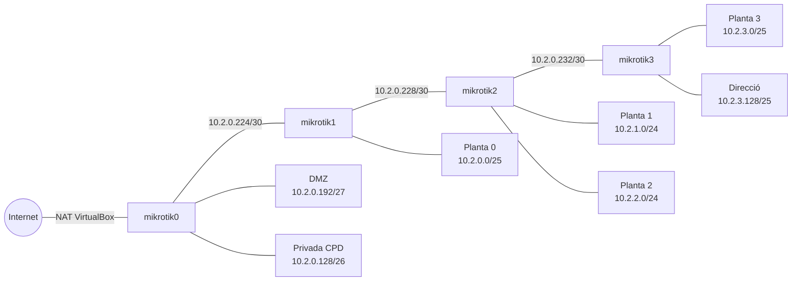

# VirtualCorp - Delegació 02

Jhoan Luis Aduviri Zambrana (jhoanluisaduvirifp25)
Rang de la delegació: **10.2.0.0/16**

En aquesta activitat he desplegat els 4 routers MikroTik de la meva delegació amb els scripts del repositori del professor, adaptats a la meva xarxa.

## 1. Disseny de la xarxa

### Xarxes

| Zona | Xarxa | Gateway | Router |
|---|---|---|---|
| Planta baixa (consergeria i expositors) | 10.2.0.0/25 | 10.2.0.1 | mikrotik1 |
| Zona privada (CPD) | 10.2.0.128/26 | 10.2.0.129 | mikrotik0 |
| DMZ | 10.2.0.192/27 | 10.2.0.193 | mikrotik0 |
| Enllaç router0 - router1 | 10.2.0.224/30 | | |
| Enllaç router1 - router2 | 10.2.0.228/30 | | |
| Enllaç router2 - router3 | 10.2.0.232/30 | | |
| Planta 1 | 10.2.1.0/24 | 10.2.1.1 | mikrotik2 |
| Planta 2 | 10.2.2.0/24 | 10.2.2.1 | mikrotik2 |
| Planta 3 | 10.2.3.0/25 | 10.2.3.1 | mikrotik3 |
| Planta 3 - Direcció | 10.2.3.128/25 | 10.2.3.129 | mikrotik3 |

He comprovat que cap xarxa es solapa amb una altra i que totes estan dins de 10.2.0.0/16. Les IPs fixes de l'enunciat (pve01 .133, dbsrv .134, infosrv .135, websrv .197, expo1-4 .33-.36 i les impressores .65) queden dins de la seva xarxa.

### Routers

Al repositori els routers es diuen `mikrotik0` a `mikrotik3`, que són el router0 a router3 de l'enunciat.

| Router | ether1 | ether2 | ether3 | ether4 | ether5 |
|---|---|---|---|---|---|
| mikrotik0 | Internet (NAT de VirtualBox, 10.0.2.15) | r0-r1 10.2.0.225/30 | dmz 10.2.0.193/27 | privada 10.2.0.129/26 | |
| mikrotik1 | no s'utilitza | r0-r1 10.2.0.226/30 | r1-r2 10.2.0.229/30 | pl0 10.2.0.1/25 | |
| mikrotik2 | no s'utilitza | r1-r2 10.2.0.230/30 | r2-r3 10.2.0.233/30 | pl1 10.2.1.1/24 | pl2 10.2.2.1/24 |
| mikrotik3 | no s'utilitza | r2-r3 10.2.0.234/30 | pl3 10.2.3.1/25 | pl3-direccio 10.2.3.129/25 | |

Els noms (r0-r1, dmz, pl0...) són les xarxes internes de VirtualBox, que fan de "cable" entre les màquines.

### Esquema



### Rutes, NAT i DNS

- Els routers fan servir **RIP** per aprendre les xarxes dels altres (ja venia als scripts del professor).
- Cada router té una ruta per defecte cap al router anterior: mikrotik3 → mikrotik2 → mikrotik1 → mikrotik0. El mikrotik0 surt a internet pel NAT de VirtualBox.
- El mikrotik0 fa **NAT** (masquerade) per ether1 perquè les IPs 10.2.x.x puguin sortir a internet.
- **DNS**: cada router pregunta el DNS al seu gateway, i el mikrotik0 el pregunta a internet. Al mikrotik0 he bloquejat el port 53 (DNS) per ether1 perquè no respongui des de fora.

## 2. Accés SSH

| Usuari | Clau | Per a què |
|---|---|---|
| sysadmin | vcorp_sysadmin (la meva) | Per administrar jo els routers |
| auditor | vcorp_auditor.pub (la del professor) | Perquè el professor pugui entrar |
| admin | | El desactivo perquè no té contrasenya |

L'usuari `auditor` té una contrasenya aleatòria que no es guarda enlloc, així que només s'hi pot entrar amb la clau del professor. Les claus privades no estan al repositori, només les públiques.

Des del PC només es pot entrar directament al mikrotik0 (port 2200). Als altres s'hi entra saltant pel mikrotik0:

```bash
ssh -i ~/.ssh/vcorp_sysadmin -p 2200 sysadmin@127.0.0.1
ssh -i ~/.ssh/vcorp_sysadmin -J sysadmin@127.0.0.1:2200 sysadmin@10.2.0.226
```

Per no escriure-ho tot he fet el fitxer `configs/ssh/ssh_config`, i llavors només cal:

```bash
ssh -F configs/ssh/ssh_config mikrotik2
```

El professor pot entrar igual però amb la seva clau i l'usuari `auditor`. El port 2200 només escolta a 127.0.0.1, així que s'ha de fer des del meu PC (per exemple a classe):

```bash
ssh -i vcorp_auditor -p 2200 auditor@127.0.0.1
ssh -i vcorp_auditor -J auditor@127.0.0.1:2200 auditor@10.2.0.226
```

## 3. Com es desplega

```bash
cp .env.example .env
make ssh-keys          # crea la meva clau vcorp_sysadmin
make deploy-routers    # crea i configura els 4 routers
make validate          # fa les proves
```

## 4. Canvis que he fet i problemes

| # | Problema | Què he fet |
|---|---|---|
| 1 | Les IPs del `deploy_routers.sh` eren 10.1.x.x (Serveis Centrals) | Les he canviat per les de la meva delegació, 10.2.x.x |
| 2 | La zona privada (10.2.0.128/26) no estava a cap router, i els servidors del CPD no tindrien gateway | L'he posat al mikrotik0, al costat de la DMZ, perquè així el router de sortida controla l'accés a tots els servidors |
| 3 | `make ssh-keys` creava una clau `vcorp_auditor` nova i sobreescrivia la del professor | He comentat aquesta línia a `create_ssh_keys.sh` |
| 4 | La clau del professor no s'instal·lava als routers | He afegit l'usuari `auditor` i la importació de la seva clau a `router_base.sh` |
| 5 | Al mikrotik1 va fallar: `input does not match any value of public-key-file` | El router tarda una mica a veure el fitxer pujat amb scp. He posat un `sleep 3` abans d'importar les claus |
| 6 | Els routers 1, 2 i 3 no podien fer ping a noms (www.google.com) | Cada router fa servir el seu gateway com a DNS |
| 7 | No podia entrar per SSH als routers 1, 2 i 3 | He activat `forwarding-enabled` al mikrotik0 per poder saltar per ell |
| 8 | L'usuari `admin` no tenia contrasenya | L'he desactivat |
| 9 | Després d'engegar els routers, a vegades es perdia el primer ping | El RIP tarda uns segons. Al script de proves espero 25 segons després d'engegar cada router |
| 10 | Al meu PC no s'instal·lava VirtualBox: `apt` donava error i el mòdul no carregava | Vaig desactivar la font `cdrom` d'apt i el Secure Boot a la BIOS |

## 5. Proves

Les proves les fa el script `automation/scripts/validate_routers.sh` (`make validate`). A cada router mira les IPs, fa ping als altres routers, a 1.1.1.1 i a www.google.com, i mostra els usuaris i les claus.

- [validacio.txt](evidencies/validacio.txt): proves després de desplegar.
- [validacio-reinici.txt](evidencies/validacio-reinici.txt): proves després d'apagar i tornar a engegar els 4 routers, per veure que la configuració es guarda.

| Prova | mikrotik0 | mikrotik1 | mikrotik2 | mikrotik3 |
|---|---|---|---|---|
| IPs correctes | OK | OK | OK | OK |
| Ping als altres routers | OK | OK | OK | OK |
| Ping a 1.1.1.1 | OK | OK | OK | OK |
| Ping a www.google.com | OK | OK | OK | OK |
| Entro amb la meva clau (sysadmin) | OK | OK | OK | OK |
| Clau del professor instal·lada (auditor) | OK | OK | OK | OK |
| admin desactivat | OK | OK | OK | OK |
| Després de reiniciar tot segueix igual | OK | OK | OK | OK |

No puc provar d'entrar amb la clau del professor perquè no tinc la seva clau privada, però he comprovat que la seva clau pública està a l'usuari `auditor` de tots els routers.
